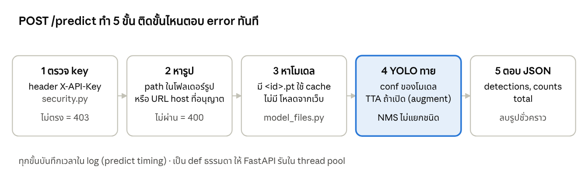
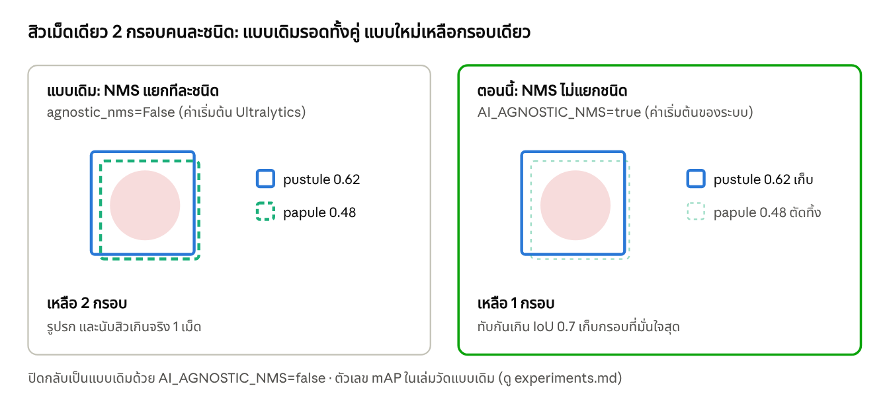
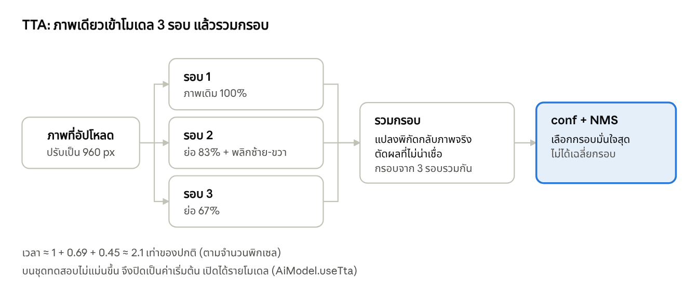

# AI Service (apps/ai)

FastAPI 0.115.5 · Ultralytics 8.4.180 · PyTorch · Python 3.12 (Docker) / venv (Windows)

## ไฟล์

| ไฟล์ | หน้าที่ |
|---|---|
| `app/main.py` | สร้าง app, CORS, ตั้ง `logging`, รวม router |
| `app/routers/health.py` | `/`, `/health` |
| `app/routers/predict.py` | `/predict` (เป็น `def` ให้รันใน thread pool เพราะดาวน์โหลด/YOLO เป็นงาน blocking) |
| `app/routers/models.py` | `/model-metrics` |
| `app/schemas.py` | Pydantic response model (`PredictResponse`, `Detection`, `ModelMetricsResponse`, `HealthResponse`) — ดูได้ที่ `/docs` เมื่อ `DEBUG=true` |
| `app/security.py` | `verify_api_key` (header `X-API-Key`) |
| `app/services/model_files.py` | `resolve_image()` / `resolve_model()` จำกัดว่าอ่านไฟล์จากที่ไหนได้, `_download()` |
| `app/services/yolo_service.py` | `ACNE_CLASSES`, cache โมเดลใน memory (`_cache` + lock), `YoloService.predict()`, `class_names_mismatch()` เตือนใน log ถ้าลำดับคลาสของโมเดลไม่ตรง |
| `app/services/model_metrics.py` | `extract_metrics()` อ่าน `train_metrics` ของ Ultralytics (`metrics/mAP50(B)`, `precision(B)`, `recall(B)`) เป็นร้อยละ + คำนวณ F1; `read_model_metrics()` โหลดด้วย `torch.load(weights_only=False)` — ไฟล์มาจากแอดมินเท่านั้น |
| `app/config.py` | `Settings` (pydantic-settings): `AI_SERVICE_API_KEY`, `STORAGE_PATH`, `MODELS_PATH`, `ALLOWED_IMAGE_HOSTS`, `ALLOWED_MODEL_HOSTS`, `AI_CONFIDENCE_THRESHOLD` (สำรอง 0.2), `AI_AGNOSTIC_NMS` (true), `AI_NMS_IOU` (0.5), `AI_NESTED_BOX_RATIO` (0.8), `DEBUG` |
| `inspect_pt.py` | สคริปต์ดูข้างในไฟล์ `.pt` (keys, results_dict, names) — ไม่ได้อยู่ใน flow |
| `requirements.txt` | pin เวอร์ชัน (ไม่มี torch — ติดมากับ ultralytics) |
| `Dockerfile` | python:3.12-slim, ติดตั้ง PyTorch รุ่น CPU ก่อน `requirements.txt` |
| `models/` | cache ไฟล์ `.pt` ที่โหลดจาก Next.js (ชื่อ `<AiModel.id>.pt`) |
| `storage/` | ไฟล์รูปชั่วคราวที่โหลดจาก URL |

## การทำงานของ `/predict`



1. ตรวจ `X-API-Key` เทียบ `settings.AI_SERVICE_API_KEY`
2. `resolve_image()` — รูป (ไม่ผ่านเงื่อนไขตอบ 400)
   - URL: ต้องเป็น `https` และ host อยู่ใน `ALLOWED_IMAGE_HOSTS` (ค่าเริ่มต้นคือ Vercel Blob) → ดาวน์โหลดเป็น `STORAGE_PATH/tmp_<uuid>.<ext>` แล้วลบใน `finally`
   - path: ต้องเป็นไฟล์ `.jpg/.jpeg/.png/.webp` ที่อยู่ใต้ `STORAGE_PATH` หรือ `<repo>/apps/images` เท่านั้น
3. `resolve_model()` — โมเดล (ไม่ผ่านเงื่อนไขตอบ 400)
   - URL: path ต้องเป็น `/api/models/<id 24 หลัก>` (และ host อยู่ใน `ALLOWED_MODEL_HOSTS` ถ้าตั้งไว้) → ดาวน์โหลดพร้อม header `X-API-Key` เก็บที่ `MODELS_PATH/<id>.pt` ถ้ามีไฟล์แล้วข้าม (cache hit)
   - path: ต้องเป็นไฟล์ `.pt` ที่อยู่ใต้ `MODELS_PATH` เท่านั้น
   - การดาวน์โหลดใช้ `urllib` timeout 120 วินาที โหลดลงไฟล์ `.tmp` แล้วค่อยย้าย
4. `YoloService().predict(image_path, model_path, confidence, augment)` — `augment=True` = Test-Time Augmentation (Ultralytics ทายหลายขนาด/พลิกภาพแล้วรวมผล)
5. `logging` บันทึกเวลาแต่ละขั้นและจำนวนกรอบ (`predict timing: ...`)

## yolo_service.py

```python
ACNE_CLASSES = {0:"blackhead", 1:"cyst", 2:"nodule", 3:"papule", 4:"pustule", 5:"whitehead"}
```

- เรียงตามตัวอักษร (ลำดับที่ Roboflow export) — **hard-code** ตอนโหลดโมเดลเทียบกับ `model.names` ถ้าไม่ตรงจะ log `WARNING ... class order differs` (ไม่หยุดทำงาน)
- `torch.set_num_threads(min(2, cpu_count))` กัน CPU throttling ใน container
- cache โมเดลตาม path ไม่มีการล้างเมื่อโมเดลถูกลบ/เปลี่ยนจากฝั่ง web
- ไม่ได้กำหนด `imgsz`, `iou`, `device` → ใช้ค่า default ของ Ultralytics (`imgsz` จากไฟล์ `.pt`, `iou` 0.7)
- `agnostic_nms=settings.AI_AGNOSTIC_NMS` (ค่าเริ่มต้น `true`) — คัดกรอบซ้ำโดยไม่แยกชนิด กันกรอบซ้อนกันคนละชนิดบนสิวเม็ดเดียว (เหตุผล: `experiments.md`)
- `iou=settings.AI_NMS_IOU` (ค่าเริ่มต้น `0.5`, Ultralytics ใช้ 0.7) — กรอบที่ทับกันเกินครึ่งเหลือกรอบเดียว กันกรอบเล็กซ้อนในกรอบใหญ่บนสิวเม็ดเดียว
- หลัง NMS: `drop_nested_boxes()` ตัดกรอบที่อยู่ในกรอบซึ่งมั่นใจกว่าเกิน `AI_NESTED_BOX_RATIO` (0.8) ของพื้นที่ตัวเอง ไม่สนชนิด — NMS ใช้ IoU จึงไม่ตัดกรอบเล็กในกรอบใหญ่ที่ขนาดต่างกันมาก (`0` = ปิด) นับ `counts` หลังตัดแล้ว

  

- ลำดับคลาส: ชื่อพหูพจน์/ตัวพิมพ์ต่างกันถือว่าตรง (`blackheads` = `blackhead`) เตือนเฉพาะเมื่อลำดับผิดจริง

## ค่า confidence และ TTA (รายโมเดล)

ตั้งในหน้าแก้ไขโมเดล เก็บที่ `AiModel.confidence` (default **0.2**, ช่วง 0.05–0.95) และ `AiModel.useTta` — ไม่มี env ตั้งทั้งระบบ

| ที่ | ใช้อย่างไร |
|---|---|
| web `callFastApiForPrediction()` (`server/analyze.ts`) | ส่ง `confidence` และ `augment` ของโมเดลหลักไปกับ `/predict` ทุกครั้ง และบันทึกค่าที่ใช้ลง `Analysis.confidence` / `usedTta` |
| ai `settings.AI_CONFIDENCE_THRESHOLD` (0.2) | สำรอง ใช้เมื่อคำขอไม่ได้ส่ง `confidence` มา (เว็บส่งเสมอ) |

เลือกค่า: ใช้ conf ที่ F1 สูงสุดจากกราฟ F1-Confidence ของโมเดลนั้น (`F1_curve.png` ตอนเทรน หรือสคริปต์ `apps/ai/scripts/eval_nms_sweep.py`)

## Environment (apps/ai/.env)

`AI_SERVICE_API_KEY` (ต้องตรงกับฝั่ง web), `DEBUG`, `STORAGE_PATH`, `MODELS_PATH`

ไม่บังคับ:

| ตัวแปร | ค่าเริ่มต้น | ใช้ทำอะไร |
|---|---|---|
| `ALLOWED_IMAGE_HOSTS` | `.public.blob.vercel-storage.com` | host ที่ยอมให้ดาวน์โหลดรูปผ่าน URL คั่นด้วย `,` ขึ้นต้นด้วย `.` = รวม subdomain |
| `ALLOWED_MODEL_HOSTS` | ว่าง (ไม่จำกัด) | host ของเว็บที่ยอมให้ดาวน์โหลดโมเดล เช่น `my-app.vercel.app` ควรตั้งเมื่อ deploy จริง |

ถ้าฝั่งเว็บตั้ง `STORAGE_PATH` เป็นโฟลเดอร์อื่นที่ไม่ใช่ `apps/images` ต้องตั้ง `STORAGE_PATH` ของ AI ให้เป็นโฟลเดอร์เดียวกัน ไม่เช่นนั้น `/predict` จะตอบ 400

## รัน

```bash
cd apps\ai
venv\Scripts\python.exe -m uvicorn app.main:app --reload --port 8000
```

Hosted บน Render free tier จะ sleep หลัง 15 นาที → ใช้ cron ping `/health`

## Test-Time Augmentation (TTA)



เปิด/ปิดรายโมเดลในหน้าแอดมิน (`AiModel.useTta`) เว็บส่ง `augment` มากับ `/predict` ทุกครั้ง ไม่มี env ตั้งทั้งระบบ

ผลวัด (โมเดล L, ชุด test): mAP@0.5 −0.26, F1 −0.79, ช้าลง ×2.1 → ปิดเป็นค่าเริ่มต้น ค่าประเมินที่ "ดึงจากไฟล์" เป็นค่าแบบไม่ใช้ TTA เสมอ
รายละเอียด วิธีทำงานของ TTA และข้อความสำหรับเล่ม: [performance/tta.md](performance/tta.md) — สคริปต์วัด `apps/ai/scripts/eval_tta.py`
