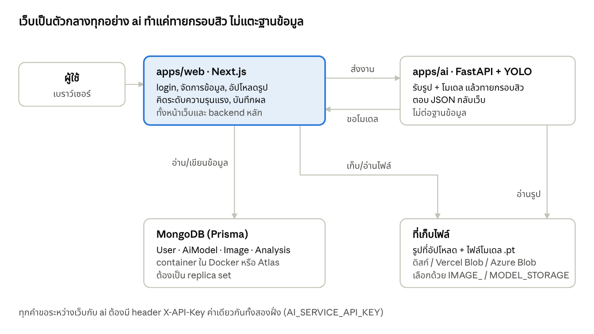
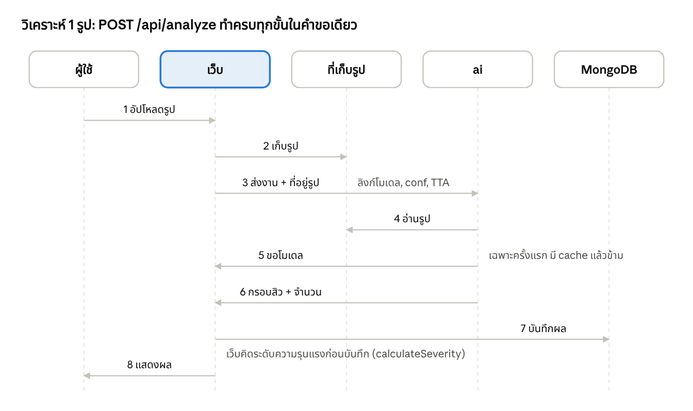
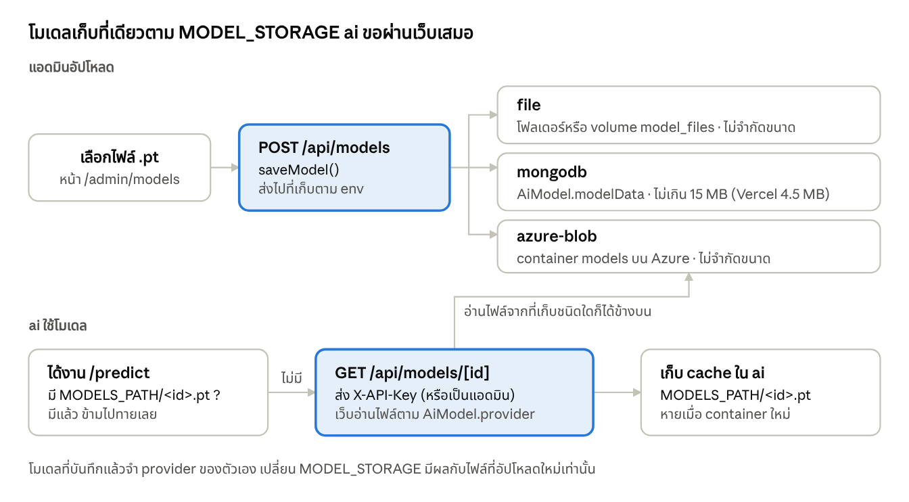
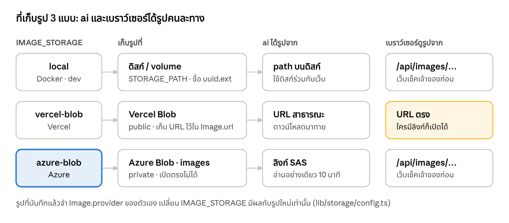
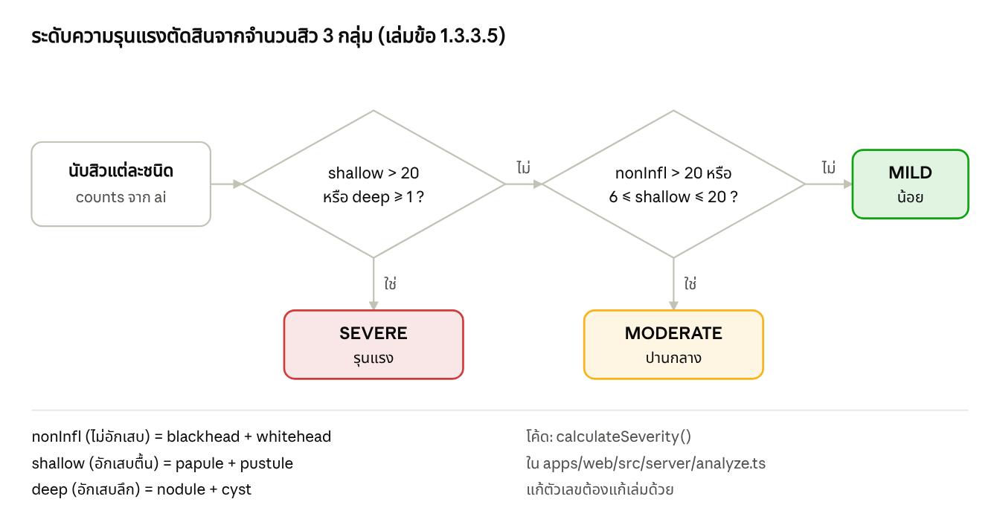
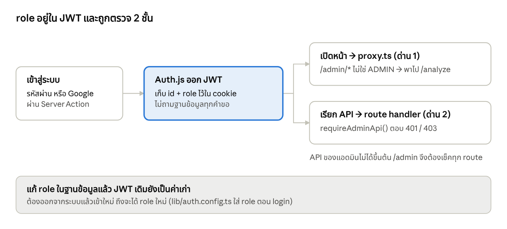
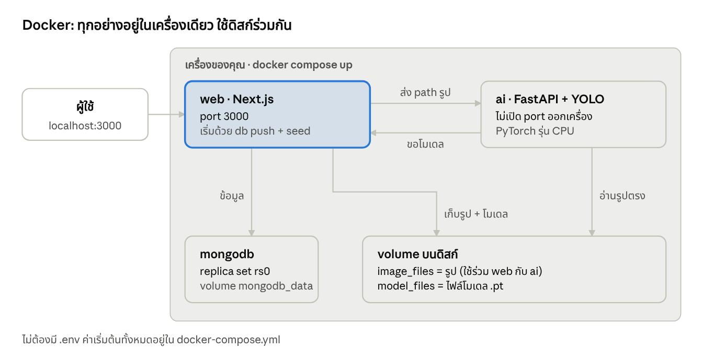

# Architecture

## ส่วนประกอบ

| ส่วน | เทคโนโลยี | หน้าที่ |
|---|---|---|
| `apps/web` | Next.js 16.2 (App Router), React 19, TypeScript, Tailwind 4, Prisma 6, Auth.js v5 (beta) | UI + Backend หลัก: auth, CRUD, อัปโหลดรูป, คำนวณ severity, บันทึกผล, สถิติ |
| `apps/ai` | FastAPI 0.115, Ultralytics 8.4.180, PyTorch | รับ path/URL ของรูปและโมเดล → รัน YOLO → คืน JSON ไม่แตะ DB |
| MongoDB | mongo:7 (replica set `rs0`) / Atlas | เก็บผู้ใช้, session ของ Auth.js, โมเดล (รวมไฟล์ `.pt`), รูป (metadata), ผลวิเคราะห์ |
| ที่เก็บไฟล์ | ดิสก์ (`apps/images/`, volume), Vercel Blob หรือ Azure Blob | ไฟล์รูปจริง และไฟล์โมเดล `.pt` (เลือกด้วย `IMAGE_STORAGE` / `MODEL_STORAGE`) |



## Environment

ระบบแต่ละชุด ตัวแปรที่เลือกที่เก็บ และการกันพลาด → **`environments.md`**

| | Docker | Vercel + Render | Azure | `npm run dev` |
|---|---|---|---|---|
| `AI_SERVICE_URL` | `http://ai:8000` | URL ของ Render | `https://<ลิงก์ acne-ai>` | `http://localhost:8000` |
| URL ที่ ai ใช้โหลดโมเดล | `INTERNAL_APP_URL=http://web:3000` | `NEXT_PUBLIC_APP_URL` | `INTERNAL_APP_URL=<ลิงก์ acne-web>` | `NEXT_PUBLIC_APP_URL` |

## Flow หลัก: วิเคราะห์สิว



```
[Client] components/analyze/image-analyzer.tsx
   │ FormData { image }  ผ่าน lib/api-client/analyze-api.ts
   ▼
[Next] POST /api/analyze  (app/api/analyze/route.ts)
   1. auth() + เช็คว่า user ยังอยู่ใน DB
   2. อ่านไฟล์จาก formData
   3. หา active model (AiModel.isActive)
   4. uploadImage()  → ดิสก์ (uuid.ext), Vercel Blob หรือ Azure Blob (ตาม IMAGE_STORAGE)
   5. callFastApiForPrediction()  → POST {AI_SERVICE_URL}/predict
        form: image_url_or_path, model_url_or_path = {appUrl}/api/models/{id}, confidence (AiModel.confidence, default 0.2), augment (AiModel.useTta)
        header: X-API-Key
   ▼
[FastAPI] /predict  (apps/ai/app/main.py)
   - รูป: ถ้าเป็น URL → ดาวน์โหลดลง STORAGE_PATH (ลบทิ้งหลังจบ), ถ้าเป็น path → อ่านได้เฉพาะไฟล์รูปใต้ STORAGE_PATH (URL รับเฉพาะ host ใน ALLOWED_IMAGE_HOSTS — Vercel Blob หรือลิงก์ SAS ของ Azure Blob)
   - โมเดล: ดาวน์โหลดจาก GET /api/models/{id} (ส่ง X-API-Key) → cache ที่ MODELS_PATH/{id}.pt (ครั้งถัดไปข้าม)
   - YoloService.predict() → { detections[], counts{}, total }
   ▼
[Next] 6. calculateSeverity(counts)  → MILD | MODERATE | SEVERE
       7. prisma.analysis.create (+ Image แบบ nested create)
       8. ตอบ { success, data: { ...result, id, severity, imageName, imageUrl, imageProvider } }
   ▼
[Client] วาดกรอบบน <canvas> (image-preview.tsx) + แสดงสรุป/คำแนะนำ (analysis-result.tsx)
```

แถบ progress บนปุ่มเป็นการจำลองด้วย `setInterval` ไม่ได้มาจากสถานะจริง

## Flow: จัดการโมเดล (Admin)



```
upload-model-dialog.tsx (ModelService.uploadModel — XMLHttpRequest มีแถบความคืบหน้าจริง)
   หน้าเว็บรู้เพดานจาก maxModelUploadBytes() ตั้งแต่เลือกไฟล์ (file ไม่จำกัด, mongodb 15 MB, Vercel 4.5 MB)
   → POST /api/models?fileName&name&version&description  (body = ไฟล์ .pt ตรง ๆ)
   → uploadModelLogic() → saveModel() (lib/storage/model-provider.ts) ตาม MODEL_STORAGE
        file:    stream ลง MODEL_STORAGE_PATH → AiModel { provider:"file", filePath:<fileName>, modelData:null }
        mongodb: อ่านเข้า Buffer (เกิน 15 MB ตอบ 413) → AiModel { provider:"mongodb", modelData }
        azure-blob: stream ขึ้น container models → AiModel { provider:"azure-blob", filePath:<ชื่อ blob> }
     isActive = (ยังไม่มีตัว active) | บันทึก DB ไม่สำเร็จ → ลบไฟล์ทิ้ง
   หมายเหตุ: /api/models ถูกยกเว้นจาก proxy.ts เพราะ proxy เก็บ body ไว้ในหน่วยความจำและตัดทิ้งเงียบ ๆ ที่ 10 MB
ตั้ง active:  POST /api/models/[id]/activate → setActiveModelLogic (ปิดตัวอื่น แล้วเปิดตัวนี้ ใน $transaction)
แก้ข้อมูล:    PATCH /api/models/[id]         → name, version, description, ค่าประเมิน
ลบ:          DELETE /api/models/[id] (โมเดลหลักตอบ 409) | DELETE /api/models { ids }  (batch ข้ามตัว active)
FastAPI ดึงไฟล์: GET /api/models/[id] (X-API-Key) → "file" stream จากโฟลเดอร์ | "mongodb" ส่ง modelData
             → cache ที่ MODELS_PATH/<id>.pt (ไฟล์ "file" ที่เครื่องนี้ไม่มี → 409 ข้อความไทย)
```

## การเก็บรูป



| โหมด | เก็บที่ | `Image.fileName` | `Image.url` | แสดงผล |
|---|---|---|---|---|
| local | `STORAGE_PATH` (Docker: volume `image_files`) หรือ `<repo>/apps/images` | `uuid.ext` | null | `GET /api/images/{fileName}` |
| vercel-blob | Vercel Blob `acne-ai/uuid.ext` | blob pathname | public URL | ใช้ URL ตรง |
| azure-blob | Azure Blob container `images` (private) | ชื่อ blob | null | `GET /api/images/{fileName}` (เช็คเจ้าของ) · ai ได้ลิงก์ SAS อายุ 10 นาที |

ลบรูป: `deleteImage()` ถูกเรียกจาก `server/history.ts` และ `server/users.ts` ก่อนลบ record และจาก `POST /api/analyze` เมื่อวิเคราะห์หรือบันทึกผลไม่สำเร็จ (ไม่ให้รูปค้าง)

## Severity (ต้องตรงกับเล่ม 1.3.3.5)

`apps/web/src/server/analyze.ts` → `calculateSeverity(counts)`



```
nonInfl = blackhead + whitehead
shallow = papule + pustule
deep    = nodule + cyst

SEVERE   ถ้า shallow > 20  หรือ deep >= 1
MODERATE ถ้า nonInfl > 20  หรือ 6 <= shallow <= 20
MILD     กรณีที่เหลือ
```

ข้อความคำแนะนำต่อระดับ: `ACNE_CARE_ADVICE` ใน `types/analyze.ts` (แสดงเฉพาะเมื่อ total > 0)

## Auth



- Auth.js v5, session แบบ **JWT**, มี PrismaAdapter (ใช้เก็บ User/Account ของ Google)
- Provider: Google, Credentials (bcrypt)
- `lib/auth.config.ts` = config ที่ edge-safe (callbacks ใส่ `id`, `role` ลง token/session) ใช้ใน `proxy.ts`
- `lib/auth.ts` = config เต็ม (adapter + providers) ใช้ฝั่ง server
- ผู้ใช้คนแรกที่สมัครผ่านฟอร์มได้ role `ADMIN` (`server/auth.ts`) ที่เหลือเป็น `USER` — ใน Docker `prisma/seed.mjs` สร้างแอดมินไว้ก่อนแล้ว คนที่สมัครทีหลังจึงเป็น `USER` · บน Atlas ที่ไม่ได้ตั้ง `SEED_ADMIN_*` seed ไม่สร้างแอดมิน (ถ้ามีผู้ใช้อยู่แล้ว ให้แก้ `role` ใน DB แล้วเข้าระบบใหม่ — ภาพใน `azure-deploy.md`)
- Google provider ถูกลงทะเบียนเฉพาะเมื่อมี `GOOGLE_CLIENT_ID` และ `GOOGLE_CLIENT_SECRET` (`lib/auth/google.ts`) ถ้าไม่มี ปุ่ม Google ในหน้า login จะแจ้งเตือนแทน
- `role` ถูกฝังใน JWT ตอน login — เปลี่ยน role ใน DB แล้วต้อง login ใหม่ถึงจะมีผล

## Docker



`docker-compose.yml` รันได้โดยไม่มีไฟล์ `.env` (รายละเอียดและสถานะ: `docker-quickstart-plan.md`)

| service | สาระสำคัญ |
|---|---|
| `mongodb` | replica set `rs0` — healthcheck เรียก `rs.initiate` เองถ้ายังไม่ได้ตั้ง เปิด port 27017 ให้เฉพาะเครื่องนี้ (`127.0.0.1`) เปลี่ยนได้ด้วย `MONGO_PORT` |
| `ai` | ไม่เปิด port ออก host, volume `image_files` (รูป ใช้ร่วมกับ web), PyTorch รุ่น CPU |
| `web` | port 3000, volume `image_files` + `model_files`, `IMAGE_STORAGE=local` `MODEL_STORAGE=file`, รอ `mongodb` healthy, ตอนเริ่มรัน `prisma db push` → `node prisma/seed.mjs` → `npm start` |

- ค่า default ทั้งหมดอยู่ใน `environment:` ของ compose — `AI_SERVICE_API_KEY` ประกาศครั้งเดียว (`x-ai-key`) ใช้ทั้ง web และ ai
- ค่าใน `environment:` ชนะค่าใน `apps/web/.env` (ซึ่งเป็นไฟล์ไม่บังคับ ใช้ใส่ `GOOGLE_CLIENT_ID/SECRET`)
- เปลี่ยนค่า default ได้ด้วย `.env` ที่ root (ดู `.env.example`)
- `docker-compose.dev.yml`: เปิด port 8000, mount ซอร์ส ai, `--reload`
- `prisma db push` ยังใช้ `--accept-data-loss` เพราะถ้า Prisma เตือนเรื่อง index แล้วไม่มี flag นี้ container จะเริ่มไม่ได้ (บน MongoDB คำสั่งนี้จัดการแค่ index ไม่ลบเอกสาร)
