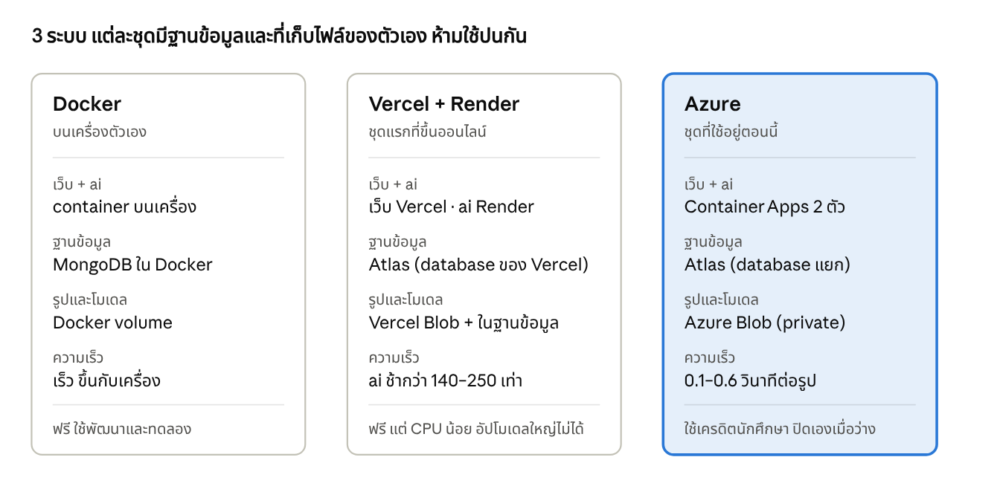
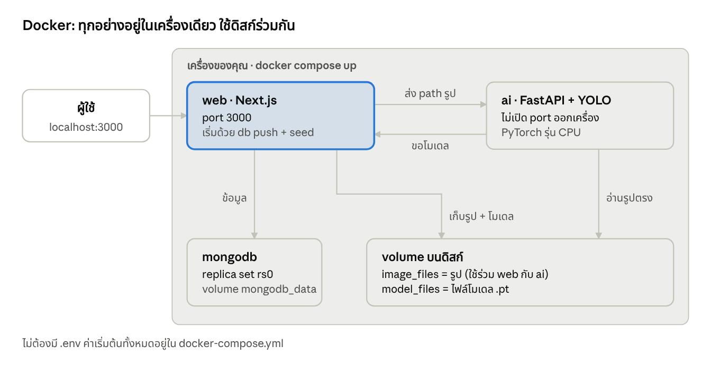
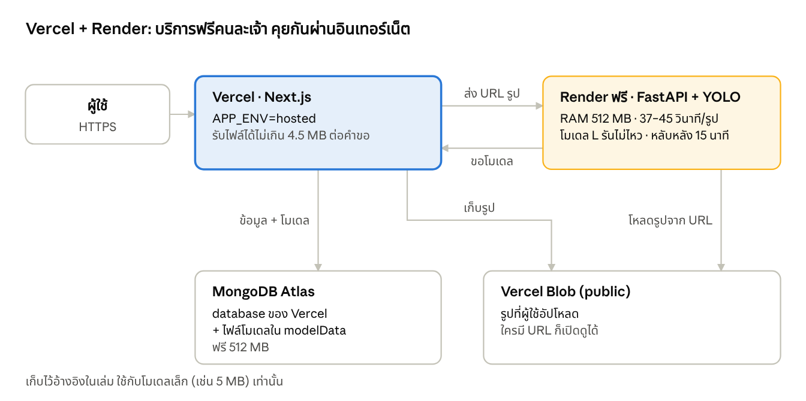
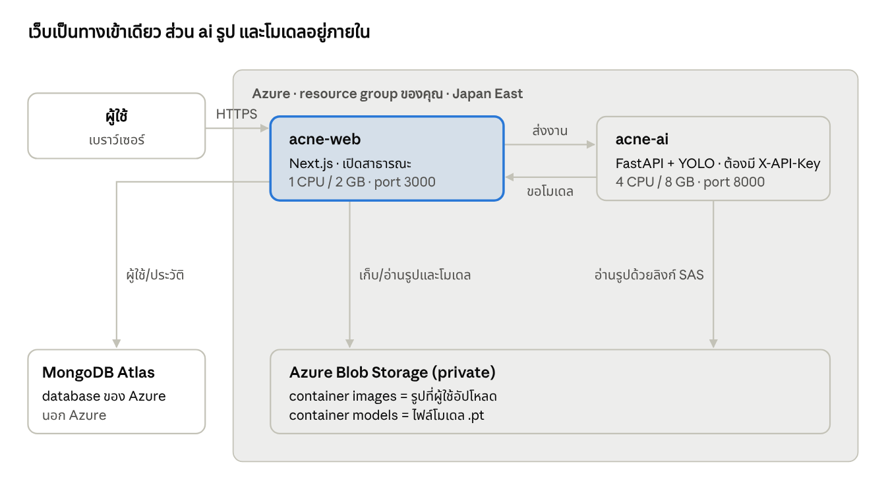
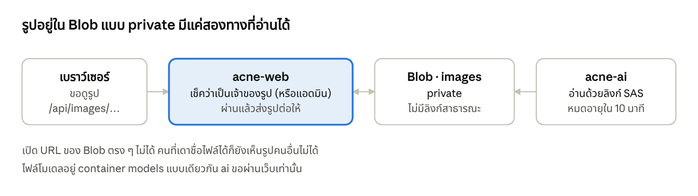
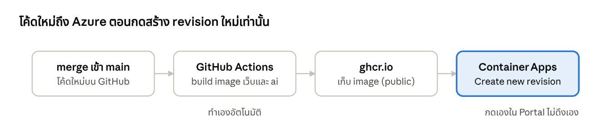
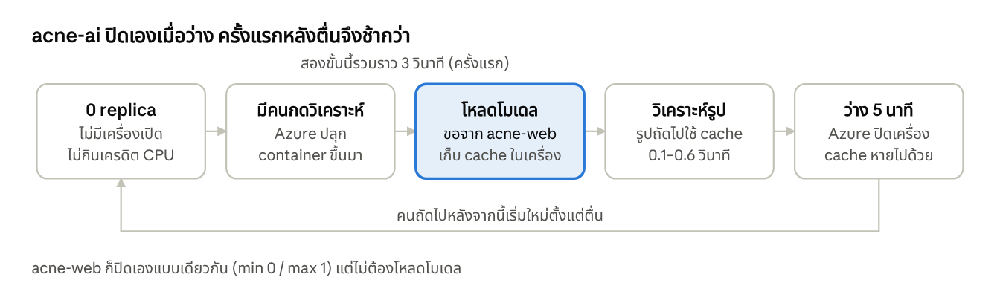
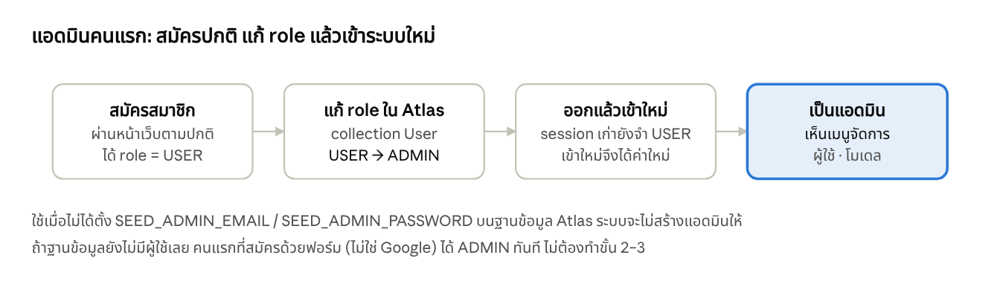
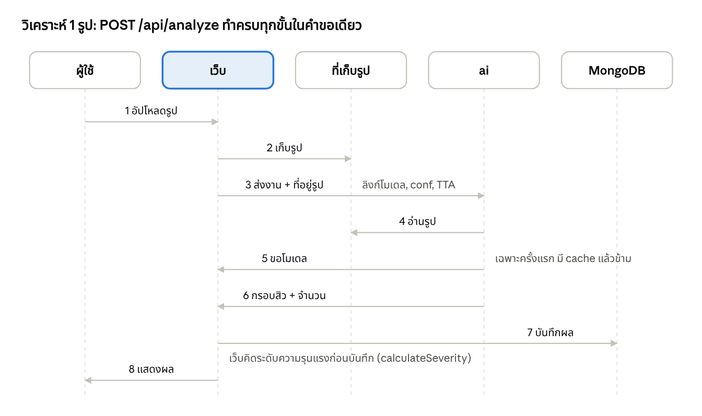

# ขึ้นระบบบน Azure (คลิกเองใน Portal)

อัปเดตล่าสุด 2026-11-04 (ปรับตามการขึ้นระบบจริง) — ตัวแปรของแต่ละ environment ดู `environments.md`

> เอกสารนี้ใช้ชื่อตัวอย่างเท่านั้น (`<ชื่อ storage>`, `<ลิงก์ acne-web>` ฯลฯ) **ห้ามใส่โดเมนจริง ชื่อ storage account รหัสผ่าน หรือ connection string ลงในไฟล์ใน repo**

สารบัญ: [ทำไมย้ายมา Azure](#why) · [เทียบ 3 ระบบ](#compare) · [Azure เก็บอะไรไว้ที่ไหน](#storage) · [ขั้นตอน 1–8](#steps) · [เจอปัญหา](#troubleshoot) · [หลังจากนี้](#after)

---

<a id="why"></a>

## ทำไมย้ายมา Azure

ระบบตัวอย่างเดิม (Vercel + Render แบบฟรี) ใช้งานได้ แต่ติดข้อจำกัด 3 ข้อที่แก้ด้วยโค้ดไม่ได้:

1. **ช้ามาก** — Render ฟรีมี RAM 512 MB / CPU น้อย วิเคราะห์รูปละ 37–45 วินาที (ครั้งแรก ~110 วินาที) ช้ากว่าเครื่องทดสอบ 140–250 เท่า (`performance/web.md`)
2. **ใช้โมเดลใหญ่ไม่ได้** — โมเดลหลักของเล่ม (YOLO26-L, 53 MB) โหลดบน Render ไม่ไหว และ Vercel รับไฟล์อัปโหลดได้ไม่เกิน 4.5 MB ต่อคำขอ
3. **ไฟล์โมเดลเก็บในฐานข้อมูล** — ต้องยัดไฟล์ลง MongoDB (`modelData`) ซึ่งจำกัด 16 MB ต่อเอกสาร

Azure for Students (เครดิตฟรี 100 USD) แก้ได้ครบ: ai ได้ CPU/RAM เต็ม ๆ, ไฟล์ทุกขนาดเก็บบน Blob Storage, และตั้ง scale-to-zero ไม่มีคนใช้ = ไม่เสียค่า CPU

<a id="compare"></a>

## เทียบ 3 ระบบ

แต่ละระบบมีฐานข้อมูลและที่เก็บไฟล์ของตัวเอง **ห้ามใช้ปนกัน** (หลักการใน `environments.md`)

| | Docker (เครื่องตัวเอง) | Vercel + Render (ตัวอย่างฟรี) | Azure (ระบบหลัก) |
|---|---|---|---|
| เว็บ (Next.js) | container `web` | Vercel | Container App `acne-web` (1 vCPU / 2 GB) |
| AI (FastAPI + YOLO) | container `ai` | Render ฟรี (512 MB) | Container App `acne-ai` (4 vCPU / 8 GB) |
| ฐานข้อมูล | MongoDB ใน container | MongoDB Atlas (database ของ Vercel) | MongoDB Atlas (**database แยก** ของ Azure) |
| รูปที่อัปโหลด | ดิสก์ (volume `image_files`) | Vercel Blob (public) | Azure Blob container `images` (**private**) |
| ไฟล์โมเดล `.pt` | ดิสก์ (volume `model_files`) | ในฐานข้อมูล `modelData` ≤ 4.5 MB | Azure Blob container `models` ไม่จำกัดขนาด |
| ai ได้รูปจาก | path บนดิสก์ร่วม | URL สาธารณะของ Vercel Blob | ลิงก์ SAS อ่านอย่างเดียว อายุ 10 นาที |
| ai ได้โมเดลจาก | `GET /api/models/[id]` | `GET /api/models/[id]` | `GET /api/models/[id]` |
| เวลาวิเคราะห์ (หลังครั้งแรก) | ~0.2 วินาที | 37–45 วินาที | ~0.1–0.6 วินาทีฝั่ง ai |
| ค่าใช้จ่าย | ค่าไฟ | ฟรี | เครดิตนักศึกษา (มีโควตาฟรีรายเดือน) |
| เหมาะกับ | ลองใช้ / พัฒนา | อ้างอิงในเล่ม | ใช้งานจริง วัดผลในเล่ม |



### ภาพแต่ละระบบ

**Docker** — ทุกอย่างอยู่ในเครื่องเดียว ใช้ดิสก์ร่วมกัน



**Vercel + Render** — บริการฟรีคนละเจ้า รูปเป็นลิงก์สาธารณะ โมเดลยัดลงฐานข้อมูล



**Azure** — เว็บเป็นทางเข้าเดียว ไฟล์ทั้งหมด private บน Blob



<a id="storage"></a>

## Azure เก็บอะไรไว้ที่ไหน อยู่ได้นานแค่ไหน

| ของ | เก็บที่ | ใครเปิดได้ | อยู่นานแค่ไหน |
|---|---|---|---|
| ผู้ใช้ ประวัติ ผลวิเคราะห์ ข้อมูลโมเดล | MongoDB Atlas (database แยกของ Azure) | เว็บเท่านั้น | จนกว่าจะลบ |
| รูปที่ผู้ใช้อัปโหลด | Blob container `images` | ไม่มีใครเปิดตรง ๆ ได้ (private) | จนกว่าจะลบผลวิเคราะห์นั้น |
| ไฟล์โมเดล `.pt` | Blob container `models` | private | จนกว่าแอดมินลบโมเดล |
| โมเดลที่ ai โหลดมาแล้ว | ดิสก์ชั่วคราวใน `acne-ai` | — | หายเมื่อ ai ดับ (scale เป็น 0) โหลดใหม่ตอนตื่น |

**รูปไปถึงคนดูได้ 2 ทาง (คนละจังหวะ):**

- **ตอนวิเคราะห์** — เว็บสร้าง *ลิงก์ SAS* (URL ของไฟล์ + ลายเซ็น, อ่านได้อย่างเดียว, หมดอายุใน 10 นาที) ส่งให้ ai โหลดรูปไปวิเคราะห์ ใช้ครั้งเดียว
- **ตอนดูประวัติ** — เบราว์เซอร์ขอ `/api/images/<ชื่อไฟล์>` จากเว็บ → เว็บเช็คว่าเป็นเจ้าของรูป → ดึงจาก Blob ส่งต่อ ทางนี้ไม่มีวันหมดอายุ



Blob แบบ Standard/LRS/Hot ราคาประมาณ 0.02 USD ต่อ GB ต่อเดือน รูปหลายพันรูปยังไม่ถึง 1 GB

---

<a id="steps"></a>

## ขั้นตอน

ใช้เวลาทั้งหมด ~45 นาที เตรียมค่าไว้ในไฟล์โน้ตบนเครื่อง (**ไม่ใช่ใน repo**):

| ค่า | ได้จาก | ใช้ที่ |
|---|---|---|
| `DATABASE_URL` | ขั้น 1 | web |
| `AI_SERVICE_API_KEY` | สุ่มเอง (ขั้น 3) | web + ai (ต้องตรงกัน) |
| `AUTH_SECRET` | สุ่มเอง (ขั้น 3) | web |
| `AZURE_STORAGE_CONNECTION_STRING` | ขั้น 4 | web |
| ลิงก์ของ `acne-ai` | ขั้น 5 | web (`AI_SERVICE_URL`) |
| ลิงก์ของ `acne-web` | ขั้น 6 | web (`AUTH_URL` ฯลฯ), Google OAuth |

> **Region:** Azure for Students บล็อกบาง region (เช่น Southeast Asia ขึ้น `RequestDisallowedByAzure`) ที่ใช้ได้มีแค่ไม่กี่ region — ระบบนี้ใช้ **Japan East** ทั้ง storage และ Container Apps
> ดูรายการที่ใช้ได้ของบัญชีตัวเอง: Cloud Shell → `az policy assignment list --query "[].parameters" -o json`

### 1. MongoDB Atlas — database ใหม่ของ Azure

ใช้ cluster เดิมได้ แต่ **ชื่อ database ต้องไม่ซ้ำกับของ Vercel** เช่น `acne_azure`

1. **Database Access → Add New Database User** → Password → ตั้งชื่อ + รหัสผ่าน (ไม่มีอักขระพิเศษจะง่ายสุด) → Built-in Role: *Read and write to any database* → Add User
2. **Network Access → Add IP Address → Allow Access from Anywhere** (`0.0.0.0/0`)
   (Container Apps ไม่มี IP คงที่ ต้องเปิดแบบนี้ — ป้องกันด้วยรหัสผ่านของ user)
3. **Database → Connect → Drivers** → คัดลอก connection string แล้วเติมชื่อ database หลัง `.net/`:
   ```
   mongodb+srv://<user>:<รหัสผ่าน>@<cluster>.mongodb.net/acne_azure?retryWrites=true&w=majority
   ```

ไม่ต้องสร้าง collection เอง เว็บสร้างให้ตอนเริ่ม (`prisma db push`)

### 2. GitHub — image บน ghcr.io

1. merge PR เข้า `main` → แท็บ **Actions** → workflow **Docker images** ต้องเขียว (~10–15 นาที ครั้งแรก)
   ถ้าไม่รันเอง: Actions → Docker images → **Run workflow**
2. หน้าโปรไฟล์ GitHub → **Packages** → `acne-web` → **Package settings** → **Change visibility → Public** แล้วทำซ้ำกับ `acne-ai`

> image เป็น public ได้ เพราะไม่มีรหัสลับใน image (รหัสทั้งหมดใส่ตอนตั้งค่า Container App)



### 3. สุ่มรหัสลับ 2 ตัว

Cloud Shell (ไอคอน `>_` แถบบน) → Bash → รัน 2 ครั้ง: `openssl rand -base64 32`
ครั้งแรก = `AI_SERVICE_API_KEY`, ครั้งที่สอง = `AUTH_SECRET` (**ห้ามใช้ค่าเดียวกับ Vercel หรือ Docker**)

### 4. Resource group + Storage account

1. **Resource groups → Create** → ชื่อ เช่น `acne-ai-rg` (region ของ resource group เป็นแค่ที่เก็บข้อมูลรายการ ใช้ region ไหนก็ได้)
2. **Storage accounts → Create**
   - **Basics:** Resource group เดิม · Storage account name: ตัวเล็ก+ตัวเลข ไม่ซ้ำใครในโลก · Region: **Japan East** · Primary service: *Azure Blob Storage or Azure Data Lake Storage Gen 2* · Performance: **Standard** · Redundancy: **LRS** (ถูกสุด)
   - **Advanced:** *Require secure transfer* = **เปิด** · *Allow anonymous access on individual containers* = **ปิด** · *Enable storage account key access* = **เปิด** · TLS 1.2 · Access tier: **Hot**
   - ที่เหลือค่าเริ่มต้น → Review + create (เช็คว่า Secure transfer = Enabled) → Create
3. เข้า storage account → **Security + networking → Access keys** → key1 → **Connection string → Show → คัดลอก** = `AZURE_STORAGE_CONNECTION_STRING`

ไม่ต้องสร้าง container เอง เว็บสร้าง `images` และ `models` (private) ให้ตอนอัปโหลดครั้งแรก

### 5. Container App: `acne-ai`

ค้นหา **Container Apps** (ไอคอนม่วง ไม่ใช่ *Container Apps Environments* หรือ *App Services*) → **Create**

**Basics**
- Resource group เดิม · name **`acne-ai`** · Deployment source: *Container image* · Region: **Japan East**
- Container Apps environment → **Create new** → ตั้งชื่อ → Create (environment นี้ใช้ร่วมกับ `acne-web`)

**Container**
- เอาติ๊ก *Use quickstart image* ออก · Image source: **Docker Hub or other registries** · Image type: **Public**
- Registry login server: `ghcr.io` · Image and tag: `<ชื่อผู้ใช้ GitHub ตัวเล็ก>/acne-ai:latest`
- Workload profile: *Consumption* · CPU and Memory: **4 CPU cores, 8 Gi memory** (เพดานของ Consumption — ไม่ต้องแบ่งกับเว็บ เพดานเป็นของแต่ละแอป) · GPU: **ไม่ติ๊ก** (image ใช้ PyTorch แบบ CPU)
- Environment variables (Source = *Manual entry*):

| Name | Value |
|---|---|
| `AI_SERVICE_API_KEY` | ค่าจากขั้น 3 |
| `ALLOWED_IMAGE_HOSTS` | `.blob.core.windows.net` |
| `STORAGE_PATH` | `/app/storage` |
| `MODELS_PATH` | `/app/models` |
| `AI_AGNOSTIC_NMS` | ไม่ต้องใส่ (ค่าเริ่มต้น `true`) — ใส่ `false` เฉพาะตอนวัดผลแบบเดิม (`experiments.md`) |
| `AI_NMS_IOU` | ไม่ต้องใส่ (ค่าเริ่มต้น `0.5`) — ใส่ `0.7` ถ้าอยากได้แบบเดิมของ Ultralytics (`experiments.md`) |
| `AI_NESTED_BOX_RATIO` | ไม่ต้องใส่ (ค่าเริ่มต้น `0.8`) — ใส่ `0` เพื่อปิดการตัดกรอบซ้อนใน (`experiments.md`) |

**Ingress:** Enabled · **Limited to Container Apps Environment** · HTTP · Target port **8000** · *Insecure connections* = **ไม่ติ๊ก**

→ Review + create → Create (2–5 นาที)

หลังสร้างเสร็จ:
1. **Application → Scale** → Min replicas **0** · Max replicas **1** · Cooldown 300 → *Save as a new revision*
   (ช่อง "Max: 1000" สีเทาคือเพดานที่ตั้งได้ ไม่ใช่ค่าที่ตั้ง · Max 1 ก็รับหลายคนพร้อมกันได้ แค่แต่ละคนช้าลง)
2. **Overview → Application Url** คัดลอกไว้ = ลิงก์ของ `acne-ai` (ขึ้นต้น `https://`)
3. ทดสอบ: เปิดลิงก์ในเบราว์เซอร์ → `{"status":"ok","service":"acne-ai",...}` · ทดสอบ key จากเครื่องตัวเอง:
   `curl.exe -i -X POST <ลิงก์ acne-ai>/predict` → ต้องได้ **403** (ไม่มี key = ถูกปฏิเสธ) · เปิด `/predict` ในเบราว์เซอร์ได้ 405 ก็ปกติ (เบราว์เซอร์ส่ง GET)



> **Environment แบบ express:** Portal บางบัญชีสร้าง environment แบบ express ให้ — ตั้ง *Insecure connections* ไม่ได้ (`'Allow Insecure' is not supported ... on express environments`) และลิงก์ของ ai อาจเปิดจากภายนอกได้แม้ตั้ง Limited ไว้ ใช้ได้ปกติเพราะ `/predict` และการโหลดโมเดลต้องมี `X-API-Key` เสมอ · ชื่อ revision เป็น `<แอป>--latest` ตลอด และแก้ค่าแล้วต้อง**รอสักครู่**กว่าเครื่องใหม่จะมาแทน

### 6. Container App: `acne-web`

**Container Apps → Create** อีกครั้ง

**Basics:** Resource group เดิม · name **`acne-web`** · Region **Japan East** · environment: **ตัวเดียวกับ `acne-ai`**

**Container:** เอาติ๊ก quickstart ออก · Docker Hub or other registries · Public · `ghcr.io` · `<ชื่อผู้ใช้ GitHub ตัวเล็ก>/acne-web:latest` · **1 CPU core, 2 Gi memory** (0.5 / 1 Gi ก็พอ — งานหนักอยู่ที่ ai)

Environment variables:

| Name | Value |
|---|---|
| `DATABASE_URL` | จากขั้น 1 |
| `AUTH_SECRET` | จากขั้น 3 |
| `AUTH_TRUST_HOST` | `true` |
| `AI_SERVICE_URL` | ลิงก์ของ `acne-ai` จากขั้น 5 — **ต้องขึ้นต้น `https://`** ไม่มี `/` ท้าย ไม่ต้องต่อ `/predict` |
| `AI_SERVICE_API_KEY` | ค่าเดียวกับ acne-ai |
| `IMAGE_STORAGE` | `azure-blob` |
| `MODEL_STORAGE` | `azure-blob` |
| `AZURE_STORAGE_CONNECTION_STRING` | จากขั้น 4 |
| `ENV_NAME` | `azure` |
| `SEED_ADMIN_EMAIL` + `SEED_ADMIN_PASSWORD` | **ไม่บังคับ** — ดูหัวข้อแอดมินด้านล่าง |

**Ingress:** Enabled · **Accepting traffic from anywhere** · HTTP · Target port **3000**

→ Review + create → Create

หลังสร้างเสร็จ:
1. **Overview → Application Url** คัดลอกไว้ = ลิงก์ของ `acne-web`
2. **Application → Containers → Edit and deploy** → เลือก container → Environment variables เพิ่ม 3 ตัว → Save → **Create** (ต้องกด Create ด้านล่างสุด ไม่ใช่แค่ Save)

| Name | Value | ใช้ทำอะไร |
|---|---|---|
| `AUTH_URL` | ลิงก์ของ `acne-web` | ระบบ login รู้ที่อยู่จริงของเว็บ — **ไม่ใส่ = ออกจากระบบแล้วเด้งไป `https://localhost:3000/login`** และ Google login ขึ้น `error=Configuration` |
| `INTERNAL_APP_URL` | ลิงก์ของ `acne-web` | ai ใช้ที่อยู่นี้โหลดไฟล์โมเดลจากเว็บ (`<ลิงก์>/api/models/<id>`) — ไม่ใส่ = ai โหลดโมเดลไม่ได้ |
| `NEXT_PUBLIC_APP_URL` | ลิงก์ของ `acne-web` | สำรองของ `INTERNAL_APP_URL` |

(`NEXTAUTH_URL` คือชื่อเก่าของ `AUTH_URL` ใน NextAuth v4 — ไม่ต้องใส่)

3. **Application → Scale** → Min **0** · Max **1**
4. รอ 1–2 นาที ดู **Monitoring → Log stream** ควรเห็น `The database is already in sync` → บรรทัด `[seed] ...` → `Ready`

**แอดมินคนแรก** (seed รันทุกครั้งที่ container เริ่ม และสร้างแอดมินเฉพาะตอนที่ยังไม่มี `ADMIN` เลยสักคน):

| ตั้งค่า | ผล |
|---|---|
| ตั้ง `SEED_ADMIN_EMAIL` + `SEED_ADMIN_PASSWORD` (รหัสเดายาก) | สร้างแอดมินจากค่านี้ให้ตอนเริ่ม |
| **ไม่ตั้ง** (ฐานข้อมูลเป็น Atlas) | **ไม่สร้าง**แอดมินเริ่มต้น (`admin@acne.local` / `Admin1234` อยู่ในคู่มือ ใครก็เดาได้) → log: `[seed] ยังไม่มีผู้ดูแลระบบ แต่ไม่สร้างแอดมินเริ่มต้นบนเว็บจริง` |

ถ้าไม่ตั้ง: **สมัครสมาชิกผ่านหน้าเว็บตามปกติ** → Atlas → database ของ Azure → collection `User` → บัญชีของตัวเอง แก้ `role` เป็น `"ADMIN"` → **ออกจากระบบแล้วเข้าใหม่** (สิทธิ์ถูกเก็บใน session ตอนเข้าสู่ระบบ ไม่เข้าใหม่จะยังเป็นผู้ใช้ทั่วไป) → ถ้าต้องการให้ seed ใส่โมเดลเริ่มต้น: `acne-web` → Revisions and replicas → **Restart** → log ต้องเป็น `[seed] มีผู้ดูแลระบบอยู่แล้ว (...) ข้าม`
(ไม่ต้อง build ใหม่ — seed อยู่ในคำสั่งตอน container เริ่ม)

ถ้าฐานข้อมูลยังไม่มีผู้ใช้เลย คนแรกที่สมัครด้วยฟอร์ม (ไม่ใช่ Google) ได้ `ADMIN` ทันที (`server/auth.ts`) ไม่ต้องแก้ `role`



> ระบบที่เคยมี `admin@acne.local` อยู่แล้ว (ขึ้นก่อนมีกฎนี้) ลบได้ตามลำดับนี้: ตั้งบัญชีตัวเองเป็น `ADMIN` → collection `AiModel` แก้ `uploadedBy` ของโมเดลที่ seed ใส่ไว้เป็น `_id` ของบัญชีตัวเอง → ลบ `admin@acne.local` → Restart
> ลบก่อนตั้งแอดมินใหม่ = ไม่มีแอดมินเหลือ · ลบก่อนย้าย `uploadedBy` = หน้าจัดการโมเดลอาจ error

### 7. ทดสอบ

1. เปิดลิงก์ของ `acne-web` → login → ป้ายบนหัวหน้าแอดมินต้องเป็น **AZURE**
2. **จัดการโมเดล → อัปโหลด** โมเดล L (`best.pt` ~53 MB) → ตั้งเป็นโมเดลหลัก → แก้ไข → ความมั่นใจขั้นต่ำ **0.26** (ค่าที่ F1 สูงสุด)
3. **วิเคราะห์** รูป 1 รูป — ครั้งแรกหลัง ai ดับอาจรอ 30 วินาที–2 นาที (ai ตื่น + โหลดโมเดล)
4. log ของ `acne-ai` ต้องเห็น `Downloading model ...` → `predict timing: ...` → `POST /predict 200 OK`
5. เปิด **ประวัติ** → รูปต้องขึ้น · Storage account → **Containers** → ต้องเห็น `images` และ `models` มีไฟล์

ถ้าวิเคราะห์ไม่ผ่าน ไล่ตามลำดับนี้ว่าติดขั้นไหน (ดู log ของแอปต้นลูกศรขั้นนั้น):



### 8. Google login (ไม่บังคับ)

ต้องใส่ `AUTH_URL` (ขั้น 6) ก่อน

1. Google Cloud Console → APIs & Services → Credentials → OAuth client → **Authorized redirect URIs** เพิ่ม `<ลิงก์ acne-web>/api/auth/callback/google` → Save
2. `acne-web` → Containers → Edit and deploy → เพิ่ม `GOOGLE_CLIENT_ID`, `GOOGLE_CLIENT_SECRET` → Create
3. รอ revision ใหม่ + ฝั่ง Google 5–10 นาที แล้วลองใหม่

---

<a id="troubleshoot"></a>

## เจอปัญหา (เคยเกิดจริงตอนขึ้นระบบ)

| อาการ | สาเหตุ | แก้ |
|---|---|---|
| สร้าง resource ไม่ได้ `RequestDisallowedByAzure` | region ไม่อยู่ในรายการที่บัญชีนักศึกษาใช้ได้ | ใช้ Japan East (ดูหัวข้อ Region) |
| `The Deployment template validation field in this step is invalid` | ค่าในแท็บใดแท็บหนึ่งไม่ผ่าน มักเป็น region | ย้อนดูแต่ละแท็บ / เปลี่ยน region |
| `'Allow Insecure' is not supported ... express environments` | environment แบบ express | ไม่ต้องติ๊ก Insecure ใช้ `AI_SERVICE_URL=https://...` |
| เว็บขึ้น "เชื่อมต่อระบบ AI ไม่ได้" + log `Failed to parse URL from //acne-ai...` | `AI_SERVICE_URL` ขาด `https:` | แก้ค่าให้ขึ้นต้น `https://` → Create → รอ revision ใหม่ |
| แก้ env แล้ว log ยังเป็นค่าเดิม | revision ใหม่ยังไม่แทนตัวเก่า / กดแค่ Save ไม่ได้กด Create | Revisions and replicas ดูเวลาสร้าง, รอ 1–2 นาที, เปิด Log stream ใหม่ |
| ออกจากระบบแล้วเด้ง `https://localhost:3000/login` | ไม่ได้ตั้ง `AUTH_URL` | ใส่ `AUTH_URL` = ลิงก์ของ acne-web |
| Google login ขึ้น `?error=Configuration` | ไม่มี `AUTH_URL` / `GOOGLE_*` / `AUTH_SECRET` หรือ redirect URI ไม่ตรง | เช็คครบ 3 อย่างในขั้น 8 แล้วดู log บรรทัด `[auth][error]` |
| "ระบบ AI ดาวน์โหลดไฟล์โมเดลไม่ได้" | ไม่ได้ตั้ง `INTERNAL_APP_URL` (ai ไปหา localhost) | ใส่ลิงก์ของ acne-web |
| `401` ตอนวิเคราะห์ | `AI_SERVICE_API_KEY` สองแอปไม่ตรงกัน | ใส่ค่าเดียวกัน |
| log ai: `class order differs from ACNE_CLASSES` | (รุ่นก่อน 2026-11-04) เตือนเพราะชื่อพหูพจน์ `blackheads` ทั้งที่ลำดับถูก | อัปเดต image — ตอนนี้เตือนเฉพาะลำดับผิดจริง |
| log web: `metadataBase property ... is not set` | ไม่ได้ตั้ง `AUTH_URL` | ใส่ `AUTH_URL` (ไม่กระทบการใช้งาน แค่รูปตัวอย่างตอนแชร์ลิงก์) |

<a id="after"></a>

## หลังจากนี้

| อยากทำ | วิธี |
|---|---|
| อัปเดตโค้ด | merge เข้า main → รอ Actions เขียว → Container App → **Revisions and replicas → Create new revision** → Create (ดึง `latest` ใหม่ — Azure ไม่ดึงเอง) |
| ย้อนกลับรุ่นเก่า | Edit and deploy → เปลี่ยน tag เป็น `sha-<commit>` |
| ดู error | Container App → Monitoring → **Log stream** |
| ดูเครดิตคงเหลือ | Cost Management + Billing → Overview (*Credits remaining*) |
| ดูค่าใช้จ่ายแยกรายตัว | Cost analysis → Scope = subscription หรือ resource group → View = *Cost by resource* (ตัวเลขช้า ~1 วัน) |
| ตั้งแจ้งเตือน | Cost Management → **Budgets → Add** เช่น 10 USD/เดือน แจ้งที่ 50% และ 90% |
| ปิดทั้งหมด | ลบ resource group (รูป/โมเดลบน Blob หายด้วย ฐานข้อมูล Atlas ไม่หาย) |

**ค่าใช้จ่ายโดยประมาณ:** Container Apps คิดเฉพาะตอนเครื่องเปิด และมีโควตาฟรีรายเดือน (180,000 vCPU-วินาที + 360,000 GiB-วินาที ใช้ร่วมกันทุกแอป) — ai 4 vCPU เปิดรวมได้ ~12 ชม./เดือนในโควตาฟรี เกินจากนั้น ~0.4 USD ต่อชั่วโมงที่ ai เปิด · Blob ~0.02 USD/GB/เดือน · ทุกครั้งที่มีคนใช้ เครื่องเปิดค้างต่อ ~5 นาที (Cooldown) · **ห้ามตั้ง Min replicas = 1 ค้างไว้**

**ข้อควรระวัง**
- เว็บรัน `prisma db push --accept-data-loss` ทุกครั้งที่เริ่ม → `DATABASE_URL` ต้องเป็น database ของ Azure เท่านั้น
- ตั้ง `azure-blob` แต่ไม่ตั้ง `AZURE_STORAGE_CONNECTION_STRING` → เว็บไม่ยอมเริ่ม (ดูข้อความใน Log stream)
- `acne-ai` ตั้ง `torch.set_num_threads(min(2, cpu))` อยู่ — ใช้ 2 เธรดต่อการวิเคราะห์ 1 ครั้ง (เผื่อหลายคนพร้อมกัน)
