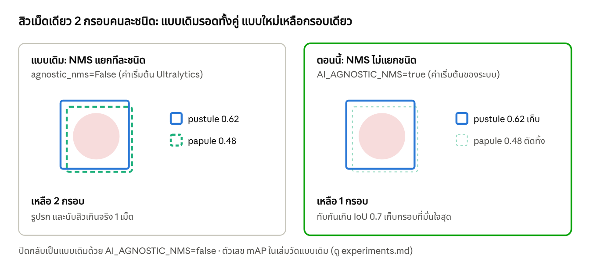

# บันทึกการทดลองและการตัดสินใจ (ฝั่งโมเดล / การวิเคราะห์)

ไฟล์นี้เป็น**สารบัญ**ของสิ่งที่ลองแล้วว่าทำไมตั้งค่าแบบที่ใช้อยู่ — ไว้ย้อนดูตอนเขียนเล่มหรือก่อนแก้ค่าใน `yolo_service.py`
ผลวัดละเอียดอยู่ในไฟล์ที่ลิงก์ไว้ เพิ่มแถวใหม่ทุกครั้งที่ทดลองหรือเปลี่ยนค่า (ล่าสุดอยู่บน)

| วันที่ | เรื่อง | ทำอะไร | ผล / ตัดสินใจ | รายละเอียด |
|---|---|---|---|---|
| 2026-11-08 | **Hard negative ไฝ/กระ (R4 fine-tune)** | เพิ่มภาพหน้าคนจาก FFHQ ที่ R3 ทายผิด 686 ภาพ (ไม่มี label) เข้า train แล้ว fine-tune ต่อจาก R3 | mAP50 valid เท่าเดิม 60.4 · ภาพไฝ 100 ภาพ ทายผิดลด 98 → **7** จุด | หัวข้อด้านล่าง |
| 2026-11-07 | ขนาดภาพตอนทาย (imgsz) | วัด R3 บน valid ที่ 640 / 960 / 1280 | mAP50 57.9 / **60.4** / 57.1 → ใช้ 960 ต่อ (1280 ช้า 2 เท่าและแย่ลง) | หัวข้อด้านล่าง |
| 2026-11-04 | **ตัดกรอบซ้อนใน (nested box)** | หลัง NMS ตัดกรอบที่อยู่ในกรอบที่มั่นใจกว่าเกิน 80% (`AI_NESTED_BOX_RATIO=0.8`) | ใช้งานจริง ยังไม่ได้วัด mAP ใหม่ | หัวข้อด้านล่าง |
| 2026-11-04 | **IoU ของ NMS 0.7 → 0.5** | ตั้ง `AI_NMS_IOU=0.5` เป็นค่าเริ่มต้น | ใช้งานจริง ยังไม่ได้วัด mAP ใหม่ | หัวข้อด้านล่าง |
| 2026-11-04 | **NMS ไม่แยกชนิด (`agnostic_nms`)** | เปิด `AI_AGNOSTIC_NMS=true` เป็นค่าเริ่มต้น | ใช้งานจริง ยังไม่ได้วัด mAP ใหม่ | หัวข้อด้านล่าง |
| 2026-11-04 | ขึ้นระบบบน Azure | ai 4 vCPU / 8 GB, web 1 vCPU / 2 GB, scale 0–1 | วิเคราะห์ครั้งแรก (ai เพิ่งตื่น + โหลดโมเดล) ~3 วินาที ครั้งถัดไป 0.1–0.6 วินาทีฝั่ง ai | `azure-deploy.md`, `performance/web.md` (ยังไม่ได้วัดเป็นตาราง) |
| 2026-11-03 | ค่า confidence รายโมเดล | เลือก conf ที่ F1 สูงสุดจากกราฟ F1-Confidence | โมเดล L ใช้ **0.26** | `ai-service.md` → ค่า confidence และ TTA |
| 2026-11-03 | Test-Time Augmentation (TTA) | วัดโมเดล L บนชุดทดสอบ 1,444 ภาพ | ไม่แม่นขึ้น ช้าลง ~2 เท่า → **ปิดเป็นค่าเริ่มต้น** เปิดได้รายโมเดล | `performance/tta.md` |
| 2026-10-04 | ความเร็วแต่ละสภาพแวดล้อม | Docker / รันในเครื่อง / Vercel+Render | Render ช้ากว่า 140–250 เท่า → เหตุผลหนึ่งที่ย้ายไป Azure | `performance/web.md` |

## Hard negative ไฝ/กระ (R4 fine-tune) — 2026-11-08

**ปัญหาที่เจอ:** โมเดลทายไฝและกระเป็น blackhead บ่อย (โมเดล n หนักกว่า L) เพราะภาพใน Acne14k เกือบทุกภาพมีสิว โมเดลแทบไม่เคยเห็นไฝที่ไม่ใช่สิว

**วิธีทำ (hard negative mining):**
1. ให้ R3 ทายภาพหน้าคนผิวใสจาก FFHQ (ตัดเป็นชิ้น 384 px แล้วย่อเป็น 640) เก็บชิ้นที่ R3 ทายว่ามีสิวที่ conf 0.26 ได้ 1,501 ภาพ
2. แบ่งกลุ่มตามสิ่งที่ทาย แล้วดูด้วยตา: A ทาย blackhead อย่างเดียว (ส่วนใหญ่ไฝ/กระ) เก็บ · B กรอบใหญ่ ≥120 px (ตา ผม ฉากหลัง) เก็บ · C สิวอักเสบกรอบเล็ก **ทิ้งทั้งกลุ่ม** เพราะอาจเป็นสิวจริง (ภาพที่คนตรวจชี้ว่าเป็นสิวจริง 30 จาก 31 ภาพอยู่กลุ่ม C)
3. ได้ 686 ภาพ ใส่ใน train แบบ label ว่าง (YOLO นับเป็น background ≈ 6.8% ของ train) และแยก 100 ภาพไว้เป็นชุดทดสอบไฝ (ไม่ได้ใช้เทรน)
4. Fine-tune ต่อจาก R3 `best.pt` ด้วยชุด train เดิมทั้งหมด + 686 ภาพ: SGD lr0 0.001, imgsz 960, `time=5` ชม. (~34 epoch)

**ผล:**

| | R3 | R4 fine-tune |
|---|---|---|
| mAP50 (valid 2,895 ภาพ, 960) | 60.4 | 60.4 |
| mAP50-95 | 30.9 | 31.2 |
| AP50 blackhead | 70.8 | 71.5 |
| ชุดทดสอบไฝ 100 ภาพ (conf 0.26) | ทายผิด 98 จุด ใน 79 ภาพ | ทายผิด **7 จุด ใน 7 ภาพ** |

**ข้อควรระวัง:** ชุดทดสอบไฝคัดมาจากภาพที่ R3 ทายผิด จึงเอียงเข้าข้าง R4 (R3 ต้องทายผิดเยอะอยู่แล้ว) ตัวเลขนี้บอกว่า R4 แก้จุดที่ R3 พลาดได้จริง แต่ยังต้องลองกับภาพผู้ใช้จริงที่มีไฝ และ R4 เทรนนานกว่า R3 จึงยังไม่ใช่การเทียบแบบเท่ากันทุกอย่าง

**ถัดไป:** เทรนใหม่ทั้งหมดด้วยค่าเดิม + hard negative (ไฝ + รอยสิว) เพื่อเป็นตัวเลขในเล่ม

## ขนาดภาพตอนทาย (imgsz) — 2026-11-07

ภาพใน Acne14k ทุกภาพมีขนาด 640×640 (Roboflow ย่อมาแล้ว) การทายที่ 960/1280 จึงเป็นการขยายภาพ ไม่ได้รายละเอียดเพิ่ม

| imgsz | mAP50 (valid) | หมายเหตุ |
|---|---|---|
| 640 | 57.9 | ตัวเลข "57.8" เดิมวัดที่ขนาดนี้ |
| 960 | **60.4** | ขนาดที่ใช้เทรน ใช้ตัวเลขนี้ในเล่ม |
| 1280 | 57.1 | ช้ากว่า 960 ประมาณ 2 เท่า |

ตัดสินใจ: ใช้ 960 ต่อ ไม่ fine-tune ที่ 1280

## ตัดกรอบซ้อนใน (nested box) — 2026-11-04

**ปัญหาที่เจอ:** ลด IoU เป็น 0.5 แล้ว รูปเดิมยังมีกรอบเล็กซ้อนในกรอบใหญ่ชนิดเดียวกัน

**สาเหตุ:** IoU = พื้นที่ทับ ÷ พื้นที่รวม ถ้ากรอบเล็กมีพื้นที่ไม่ถึงครึ่งของกรอบใหญ่ IoU ก็ต่ำกว่า 0.5 แม้จะอยู่ข้างในทั้งกรอบ — ปรับ IoU อย่างเดียวแก้ไม่ได้ ต้องลดต่ำมากจนสิวที่อยู่ติดกันโดนตัดด้วย

**ที่แก้:** `drop_nested_boxes()` ใน `yolo_service.py` ทำงานหลัง NMS — เรียงกรอบตามความมั่นใจ แล้วตัดกรอบที่ **พื้นที่ของตัวเองอยู่ในกรอบที่มั่นใจกว่าเกิน 80%** (หรือกรอบที่มั่นใจกว่าอยู่ในตัวมันเกิน 80%) ไม่สนชนิด จำนวนสิว (`counts`) นับหลังตัดแล้ว
ปิดได้ด้วย env ฝั่ง ai `AI_NESTED_BOX_RATIO=0`

**ผลกระทบที่ต้องรู้:** สิวเม็ดเล็กที่อยู่บนสิวเม็ดใหญ่จริง ๆ จะเหลือกรอบเดียว (ยอมรับได้ เพราะบนภาพแยกไม่ออกอยู่แล้ว) · ตัวเลข mAP ในเล่มไม่ได้รวมขั้นนี้

## IoU ของ NMS 0.7 → 0.5 — 2026-11-04

**ปัญหาที่เจอ:** หลังเปิด `agnostic_nms` แล้ว (โมเดล L เปิด TTA) ยังเห็นกรอบซ้อนกันบนสิวเม็ดเดียว แต่เป็น**ชนิดเดียวกัน** — กรอบเล็กอยู่ในกรอบใหญ่ (เช่น ตุ่มหนอง 2 กรอบ, ตุ่มแดง 2 กรอบ) นับสิวเกินจริง

**สาเหตุ:** NMS ลบกรอบก็ต่อเมื่อทับกัน**เกิน** IoU 0.7 (ค่าเริ่มต้นของ Ultralytics) กรอบเล็กในกรอบใหญ่มี IoU = พื้นที่เล็ก ÷ พื้นที่ใหญ่ ซึ่งมักอยู่ราว 0.5–0.6 จึงรอดทั้งคู่ ไม่เกี่ยวกับ agnostic หรือ TTA

**ที่แก้:** ส่ง `iou=settings.AI_NMS_IOU` (ค่าเริ่มต้น `0.5`) — กรอบที่ทับกันเกินครึ่งเหลือกรอบที่มั่นใจสุด
กลับเป็นแบบเดิมได้ด้วย env ฝั่ง ai `AI_NMS_IOU=0.7` (ไม่ต้อง build ใหม่)

**ผลกระทบที่ต้องรู้:** สิว 2 เม็ดที่อยู่ติดกันจนกรอบทับเกินครึ่งจะเหลือกรอบเดียว และตัวเลข mAP ในเล่มวัดที่ 0.7

**ยังต้องทำ:** `eval_nms_sweep.py` ลอง iou 0.45 / 0.6 / 0.7 อยู่แล้ว — เพิ่ม 0.5 ตอนรันบน Kaggle แล้วบันทึกผลลงตารางด้านบน

## NMS ไม่แยกชนิด (`agnostic_nms`) — 2026-11-04

**ปัญหาที่เจอ:** บนเว็บ Azure สิวเม็ดเดียวมีกรอบซ้อนกัน 2 กรอบคนละชนิด (เช่น *ตุ่มหนอง* ทับ *ตุ่มแดง*) ทำให้รูปดูรก และนับจำนวนสิวเกินจริง

**สาเหตุ:** หลังโมเดลทายกรอบ YOLO ใช้ Non-Maximum Suppression (NMS) ลบกรอบที่ซ้อนกัน ค่าเริ่มต้นของ Ultralytics ทำ NMS **แยกทีละชนิด** — กรอบที่ทับกันแต่คนละชนิดจึงรอดทั้งคู่
สิว papule กับ pustule (และ nodule กับ cyst) หน้าตาใกล้กันมาก โมเดลจึงให้คะแนนทั้งสองชนิดกับเม็ดเดียวกันบ่อย

**ที่แก้:** ส่ง `agnostic_nms=True` ทุกครั้งที่ทาย (`YoloService.predict`) → NMS ไม่สนชนิด กรอบที่ทับกันมาก (IoU > 0.7) เหลือกรอบที่มั่นใจสุดกรอบเดียว
ปิดกลับเป็นแบบเดิมได้ด้วย env ฝั่ง ai `AI_AGNOSTIC_NMS=false` (ไม่ต้อง build ใหม่)

**ผลกระทบที่ต้องรู้:**
- ตัวเลข mAP / F1 ในเล่มวัด**แบบเดิม** (แยกชนิด) — ระบบตอนนี้อาจได้ตัวเลขต่างไปเล็กน้อย
- สิว 2 เม็ดคนละชนิดที่อยู่ติดกันมากจนกรอบทับเกิน 70% จะเหลือกรอบเดียว (เกิดน้อย)

**ยังต้องทำ:** วัดผลเทียบแบบเดิมด้วย `apps/ai/scripts/eval_nms_sweep.py` บน Kaggle (ลองทั้ง `agnostic` true/false × iou × imgsz อยู่แล้ว) แล้วบันทึกผลลงตารางด้านบน + เขียนในเล่ม
